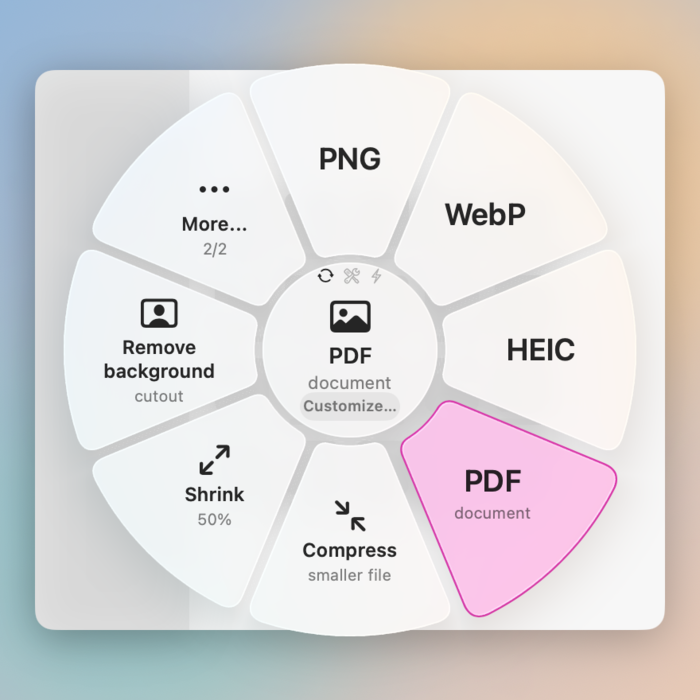
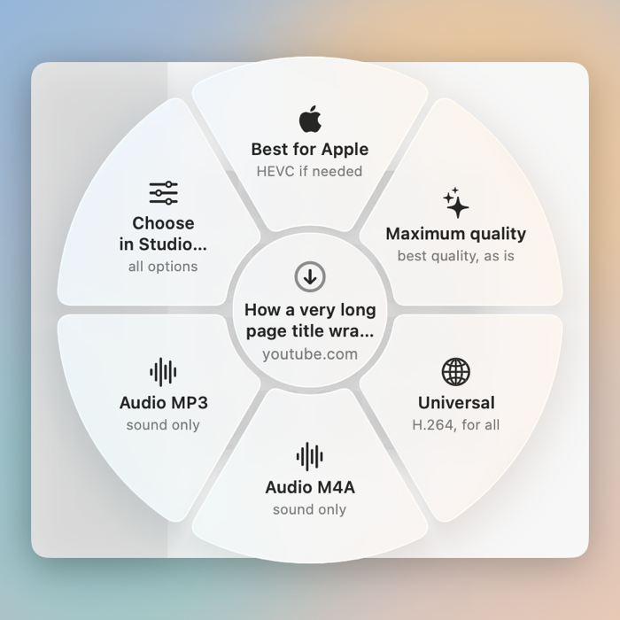
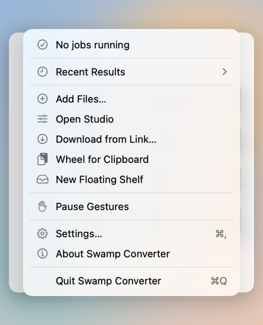
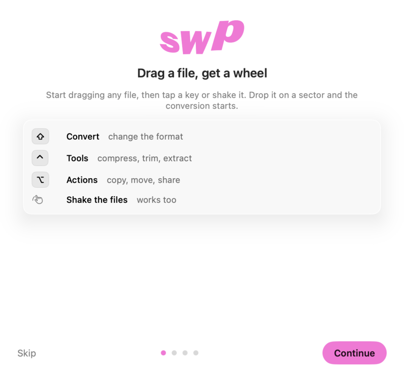
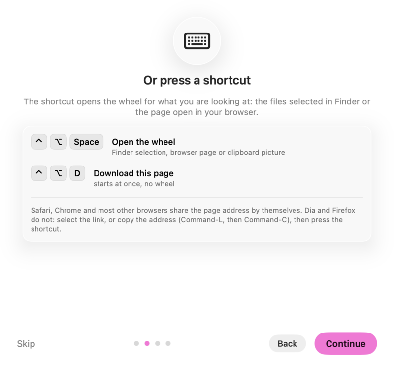
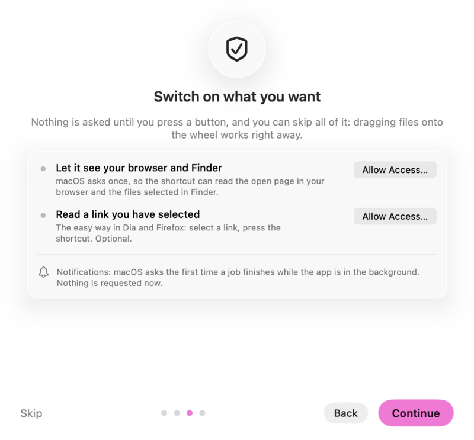
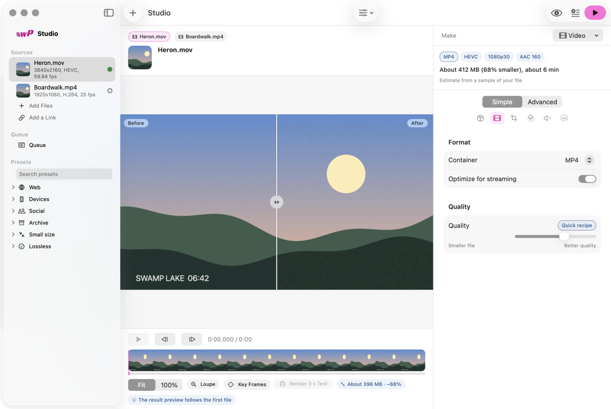

<div align="center">

<picture>
  <source media="(prefers-color-scheme: dark)" srcset="docs/screenshots/wheel-convert-dark.png">
  
</picture>

# Swamp Converter

**Drag a file. A wheel appears. Drop it on what you want.**

Convert, compress, download and tidy files from a radial menu that opens right where you are working.
Everything runs on your Mac.


[Install](#install) · [Your first minute](#your-first-minute) · [Full guide](docs/GUIDE.md) · [Settings reference](docs/SETTINGS.md) · [Known limits](#honest-limits)

</div>

---

## Why you might like it

Made for creators who live in files: footage, pictures, PDFs, audio, links to reference videos. No window to open, no format list to scroll, no account.

- **One gesture.** Start dragging any file, tap a key (or shake it), and a wheel opens under the pointer. Drop on a sector and the work starts.
- **Same engine, two speeds.** The wheel is the quick way; the **Studio** is a HandBrake-class window when you want every option, a before/after preview and a queue.
- **Links too.** Press a shortcut over a web page and the wheel offers *Best for Apple*, *Maximum quality*, *Universal*, *Audio M4A* or *Audio MP3*.
- **Honest conversions.** Every operation is run on real files in the test suite and judged by an independent reader (the format is sniffed from the bytes, the result must decode and keep its content). See the [conversion matrix](docs/conversion-matrix.md).
- **Private.** No telemetry, no account. The network is used only by the downloader, only after you agree, and never for anything else.
- **Small and quiet.** About 10 MB, nothing running while you do not use it.

<div align="center">
<picture>
  <source media="(prefers-color-scheme: dark)" srcset="docs/screenshots/wheel-link-dark.png">
  
</picture>
&nbsp;

</div>

## Install

1. Download **SwampConverter.zip** from the [latest release](../../releases/latest) and unzip it.
2. Drag **Swamp Converter.app** into *Applications*.
3. Open it. The first time, macOS says it cannot check the app: open **System Settings > Privacy & Security**, scroll to *Security* and click **Open Anyway**. (The app is signed ad hoc, not with a paid Apple Developer ID, so macOS asks once. See [Honest limits](#honest-limits).)

Needs **macOS 26 (Tahoe) or newer** on an Apple silicon Mac. The app asks for nothing when it starts; a short tour walks you through the few things worth switching on.

Prefer to build it yourself? Command Line Tools are enough, no Xcode licence needed: see [Build from source](#build-from-source).

## Your first minute

| | |
|---|---|
| **1. Drag** | Pick up any file in Finder (or a picture from a web page) and start dragging. |
| **2. Open the wheel** | While dragging, **tap Shift** (Convert), **Control** (Tools) or **Option** (Actions), or just **shake** the file. |
| **3. Drop** | Release over a sector, for example *PNG*, *Compress* or *PDF*. A small card shows the progress, and the result appears next to the original. |

Hold **Command** while you release to open that operation in the Studio instead and choose its options first.

No dragging? Press **⌃⌥Space** over a page in your browser, a selection in Finder, or a picture on the clipboard. (If macOS already uses that chord, the app picks the next free one and shows it in *Settings > Shortcuts*; on many Macs it is **⌃⌥⌘Space**.) **⌃⌥D** downloads the page in front of you straight away.

<div align="center">



</div>

The step-by-step guide, with every key and what it does, is in **[docs/GUIDE.md](docs/GUIDE.md)**.

## What it can do

| Area | Examples |
|---|---|
| **Images** | PNG, JPG, WebP, HEIC, AVIF, TIFF, ICO, PDF; compress, shrink, rotate, flip, square, remove background, strip location and camera data |
| **Video** | MP4, MOV, MKV, WebM, GIF; compress, trim, speed up, mute, join, thumbnail, extract audio; *Best for Apple* re-encodes only when needed (HEVC, 10-bit and HDR kept) |
| **Audio** | MP3, M4A, FLAC, WAV, AIFF, OGG, Opus; compress, normalize, trim, join; on-device transcription |
| **PDF and documents** | merge, split, rotate, extract pages, protect, unlock, optimize, PDF to images, PDF to text, OCR; DOCX, ODT, RTF, Markdown, HTML, EPUB and plain text; slides and spreadsheets (with LibreOffice) |
| **Subtitles and archives** | SRT, VTT, TXT; ZIP, tar, tar.gz, pack and unpack |
| **Sizes** | *Fit to size* for a target size for WhatsApp, Telegram, Discord or mail; ready-made packs for social posts, web and icons |
| **Links** | YouTube and many other sites through yt-dlp: up to 8K, audio only, subtitles, a time range |
| **Around your files** | Floating Shelf, Finder Services (*Convert with Swamp Converter*), drop on the menu-bar icon (or the Dock icon, which is there while a window is open), watched folders, the `swamp` command line |

120 operations, 101 of them checked by a content oracle in the [conversion matrix](docs/conversion-matrix.md).

<div align="center">

</div>

## Permissions, in plain words

Nothing is requested at launch. The tour and **Settings > General > Setup** show what is on and what is not, each with a button.

| Permission | What for | Needed? |
|---|---|---|
| **Automation** (Finder, browsers) | So the shortcut can read the page open in your browser and the files selected in Finder. macOS asks once. | Yes, for the shortcut |
| **Accessibility** | So the shortcut can read a link you have **selected** in any app. The way to go in Dia and Firefox. | Optional |
| **Notifications** | One message when a job finishes while the app is in the background. | Optional |
| **Open at login** | Keeps the wheel ready after a restart. It is switched on the first time the app starts (macOS shows its own “Login Item Added” notice); turn it off in *Settings > General* any time. | Optional |
| **Folder access** | When you pick a folder to watch or to write into. | When you choose it |

## Browsers

| Browser | The shortcut reads the open page |
|---|---|
| Safari, Chrome, Edge, Brave, Vivaldi, Opera, Arc, Chromium | Directly (after the one-time Automation question) |
| **Dia**, **Firefox** | They do not report the page you are on reliably. **Select the link**, or copy the address (**⌘L**, then **⌘C**), then press the shortcut. |
| Any other browser | Detected automatically (anything macOS treats as a web browser) and tried the same way as Chrome; if it does not answer, you get the same copy-the-address hint |

## Honest limits

- **Ad-hoc signature.** The app is not signed with a paid Developer ID and not notarized, so macOS asks you to confirm it once (*Open Anyway* in System Settings > Privacy & Security), and macOS may ask for Accessibility and Automation again after an update.
- **Downloads need yt-dlp** (never bundled). *Settings > Downloader* can install it for you, only after you agree, over HTTPS with a checksum check. YouTube also needs a JavaScript runtime (deno, node, bun or quickjs). Use it only for content you have the right to download; sites' terms may restrict downloading. DRM-protected video is not supported.
- **Optional programs** (ffmpeg, LibreOffice, Pandoc, ImageMagick, cwebp) are not bundled. Without them the operations that need them stay on the wheel but dimmed, with a hint on how to install what is missing (`brew install ffmpeg`, …). *Settings > Tools* shows what was found.
- **Language.** English only.
- HDR video is kept as HDR by default; *Convert to SDR* needs an ffmpeg built with tone-mapping support. macOS OCR has no Latvian model; transcription depends on the speech models installed in macOS.
- Two compiler warnings about `AVMutableVideoComposition` (deprecated in macOS 26) are known and accepted.

## Command line

```sh
swamp convert photo.heic --op jpg --out ~/Desktop
swamp download "https://example.com/video" --mode best --consent
swamp list-ops --kind video
swamp presets
swamp help convert
```

The command is the same app binary; `scripts/install.sh` links it as `swamp`.

## Build from source

Only the Command Line Tools are needed. Everything builds into `~/Library/Caches/SwampConverter`; the repository stays clean.

```sh
./build.sh typecheck all     # fast type-check of the whole project
./build.sh selftest          # the built-in tests (isolated folder, no network)
./build.sh snapshot <dir>    # offscreen screenshots of the interface
./build.sh package           # build, ad-hoc sign, write dist/SwampConverter.zip
scripts/install.sh           # install into ~/Applications and link `swamp`
```

Architecture, module rules and how to add an operation: [docs/ARCHITECTURE.md](docs/ARCHITECTURE.md).

## Credits and license

Inspired by **Sweetch** by [@mmmorozov](https://github.com/mmmorozov) (MIT) and by the ease of **HandBrake**. The code is Swift written for this app; one MIT-licensed library (KeyboardShortcuts) is listed in [THIRD-PARTY-NOTICES.md](THIRD-PARTY-NOTICES.md).

Made by **Andris Ansons**: [GitHub](https://github.com/aansonsa) · [Instagram](https://www.instagram.com/aaa.aaa.aaa.aaa.aaa.aaaaaa)

[MIT](LICENSE) © 2026 Andris Ansons
