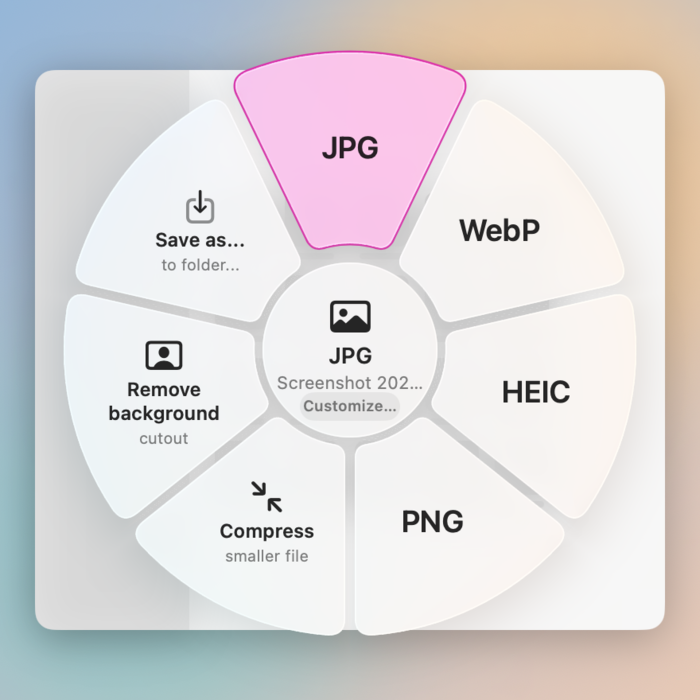
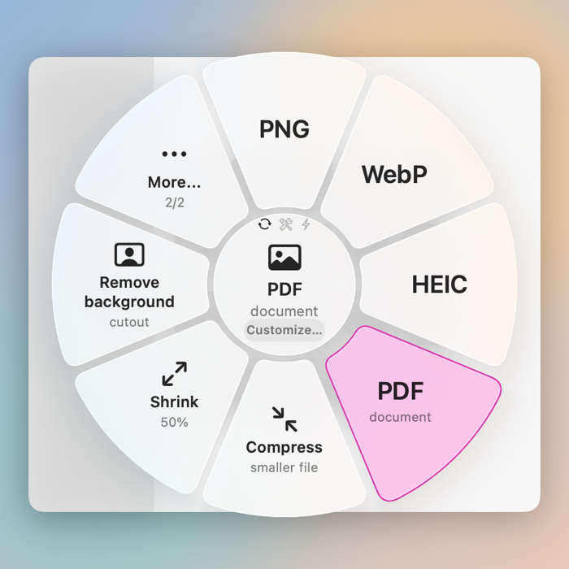
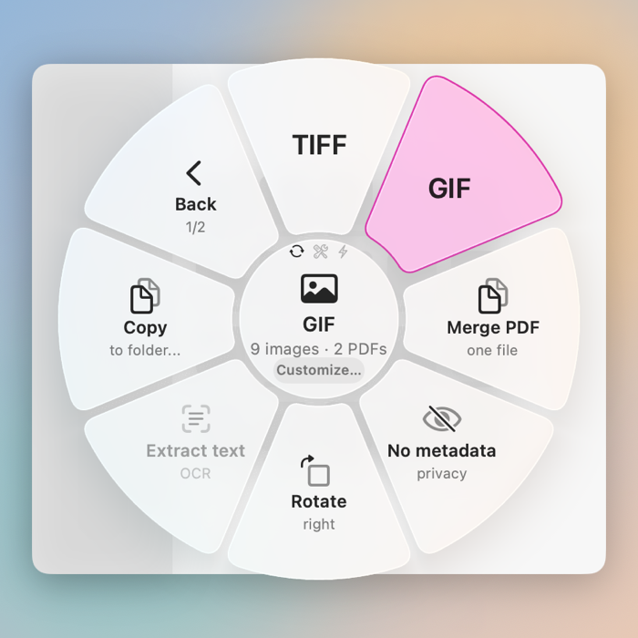
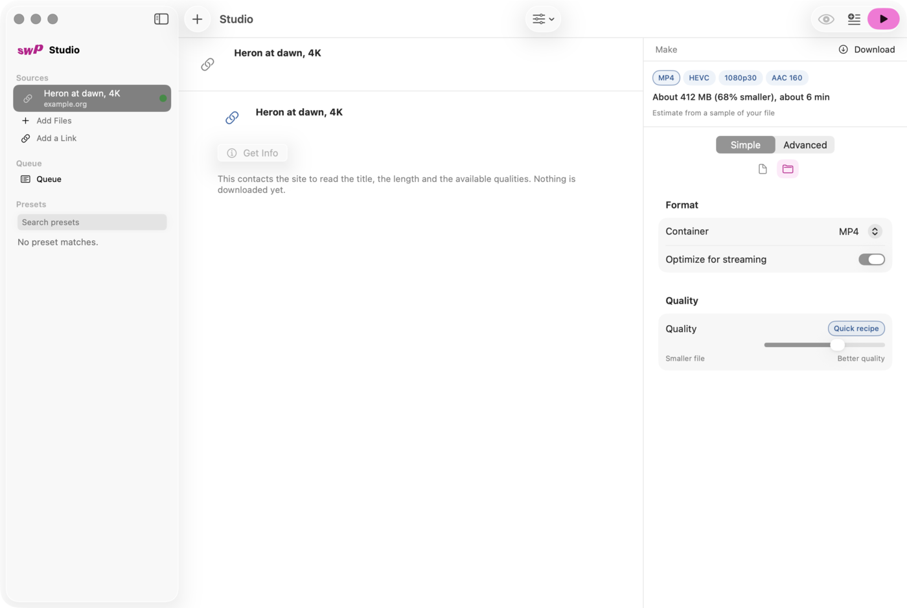
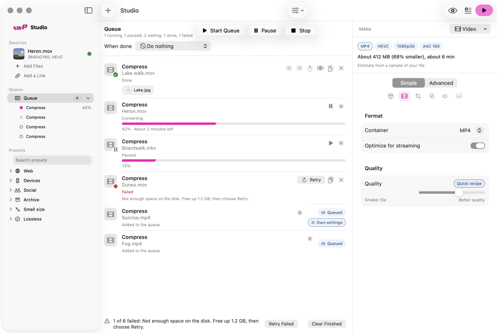
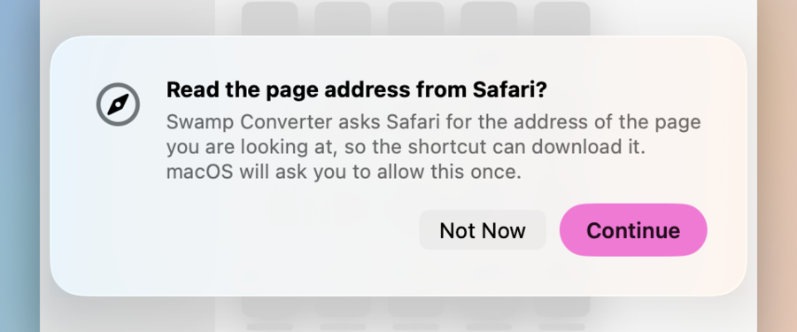

# Swamp Converter: the guide

Two layers. **Part 1** is everything most people need, in a few minutes. **Part 2** is the detail: every key, every mode, what to do when something does not work.

Contents: [Install](#install) · [Part 1: the short version](#part-1-the-short-version) · [Part 2: in detail](#part-2-in-detail) · [Troubleshooting](#troubleshooting)

---

## Install

1. Download `SwampConverter.zip` from the [latest release](../../../releases/latest) and unzip it.
2. Move **Swamp Converter.app** to *Applications*.
3. Open it. The first time, macOS says it cannot check the app. Open **System Settings > Privacy & Security**, scroll to *Security* and click **Open Anyway**, then confirm. You only do this once: the app is signed ad hoc (no paid Apple Developer ID), so macOS asks before it opens an app that was downloaded. (If you prefer Terminal: `xattr -dr com.apple.quarantine "/Applications/Swamp Converter.app"`.)

It needs **macOS 26 (Tahoe) or newer** on an Apple silicon Mac. A small icon appears in the menu bar and a four-page tour opens. You can skip it, and reopen it any time from *About > Show the Welcome Tour*.

The app starts with your Mac (turn this off in *Settings > General > Startup and quit*).

---

## Part 1: the short version

### Open the wheel by dragging

1. Start dragging any file (or a picture from a web page).
2. While you are still dragging, **tap one key**, or **shake** the file:

| You do | You get |
|---|---|
| Tap **Shift** | the **Convert** wheel: formats such as PNG, JPG, PDF, MP3 |
| Tap **Control** | the **Tools** wheel: compress, shrink, trim, join, merge, extract text, remove background |
| Tap **Option** | the **Actions** wheel: copy, move, copy path, Quick Look, share, reveal, trash |
| **Shake** the file | the Convert wheel |

3. Drop the file on a sector. It runs. The result appears next to the original, and a small card shows the progress.

"Tap" means press and release the key **on its own**, after you started dragging. Holding it before you start the drag, or pressing two keys, does not count. Tap a different key while the wheel is open and it switches to that wheel without ending the drag.

### Open the wheel with a shortcut

No dragging needed:

| Press | What happens |
|---|---|
| **⌃⌥Space** | opens the wheel for what you are looking at: a page in your browser, files selected in Finder, or a picture on the clipboard |
| **⌃⌥D** | downloads the page in your browser at once, without the wheel |

If macOS already uses ⌃⌥Space (it does when you have several keyboard layouts), the app takes the next free chord, usually **⌃⌥⌘Space**. *Settings > Shortcuts* always shows the chord that is really registered, and lets you record your own.

With nothing selected and a picture on the clipboard, the same shortcut offers to convert the picture:

### Want to choose the options first?

Hold **Command** when you drop on a sector: the operation opens in the **Studio** with all its options instead of running at once.

### Switch on the few helpful things

*Settings > General > Setup* lists what is switched on and what is not, each with a button. See [Permissions](#permissions-what-and-why).

---

## Part 2: in detail

### The wheel

 

- A ring holds up to **8 sectors**. With 8 operations or fewer they all show; with more, the ring shows **7** and a **More…** sector with up to **8 more** behind it (the second ring ends in **Back**). Everything else is in the Studio. You choose and order them in *Settings > Wheel > Layout*.
- The centre of the wheel (the **hub**) shows what is under the pointer: the name, a hint, and a **Customize…** capsule. The three small icons above it show which wheel you are on (Convert, Tools, Actions).
- Hover over **More…** while dragging for a moment (a quarter of a second by default; adjustable) and the second ring opens. **Back** returns.
- Operations that cannot work right now (a missing tool, for example) stay in place but dimmed, with a hint saying why. Operations that make no sense for the kind of file you are dragging are simply not on the wheel.

#### What each modifier does, exactly

During a drag:

| Gesture | Opens | Notes |
|---|---|---|
| Tap Shift | Convert | the default; change it in *Settings > Wheel* |
| Tap Control | Tools | the default |
| Tap Option | Actions | the default |
| Shake | Convert | always Convert, whatever keys you assign; sensitivity is adjustable |
| Tap the **same** key again | the *repeat* sector | one sector that repeats your last action |
| Tap **another** key | that wheel | switches live, the drag continues |
| Release over a sector | runs its quick recipe | |
| Release over a sector holding **Command** | opens the Studio for it | on by default (*Command opens the Studio*) |
| Release outside the wheel, over the hub, or over a dimmed sector | nothing runs | the files slide back to where they came from |
| Release over the **Customize…** capsule in the hub | opens the Studio for your last choice | |
| Press **Esc** | closes the wheel | the drag carries on |

Command is not a wheel key by default, because it has its own job at the drop (open the Studio); *Settings > Wheel* lets you give any wheel Shift, Control, Option, Command or no key at all (choosing a key another wheel uses swaps the two). A plain drop with no tap and no shake never opens the wheel, so normal dragging is untouched. *Pause Gestures* in the menu bar switches off the drag gesture and pauses watched folders; the shortcuts, Services and the Dock icon keep working.

#### When the wheel was opened with a shortcut (click mode)

There is no drag, so you click or use the keyboard:

| Key | Does |
|---|---|
| ← ↑ → ↓ | move between sectors (they wrap around) |
| **Return** / **Space** | run the highlighted sector |
| **1** to **9** | run the sector at that position |
| **Tab** / **Shift-Tab** | next / previous page (*More…* / *Back*); with only one page, cycles Convert, Tools, Actions |
| **R** | show the "repeat last action" view |
| **P** | switch *paste back* on or off: whether the finished picture is also put back on the clipboard (clipboard wheel only; on by default) |
| **E**, or hold **Option** or **Command** while you click | Customize: open the highlighted operation in the Studio |
| **Esc**, a right-click, or the shortcut again | close the wheel |

### Links and downloads

Press the wheel shortcut (**⌃⌥Space**, or the chord *Settings > Shortcuts* shows, often **⌃⌥⌘Space**) over a web page. The wheel is headed by the page title and site, and offers:

| Sector | Gives you |
|---|---|
| **Best for Apple** | a file that plays perfectly on Apple devices: kept as is when it already fits, otherwise HEVC (10-bit and HDR are kept) |
| **Maximum quality** | the best quality the site has, as is, without re-encoding |
| **Universal** | H.264 (up to 1080p), plays everywhere |
| **Audio M4A** / **Audio MP3** | sound only |
| **Choose in Studio…** | all download options |

 

The first time, a sheet asks for your **consent** to use the network, and offers to install **yt-dlp** (the program that does the downloading). Nothing is installed or downloaded before you agree. YouTube also needs a JavaScript runtime (deno, node, bun or quickjs); the sheet tells you if it is missing.

**Which browsers?** Safari, Chrome, Edge, Brave, Vivaldi, Opera, Arc and Chromium hand the app the address of the open tab. **Dia** and **Firefox** do not report it reliably, so for them: **select the link** (or press **⌘L, ⌘C** to copy the address) and then press the shortcut. Any other browser is detected automatically and tried like Chrome. If it does not answer you get the same hint. When the link came from the clipboard in a browser, **⌃⌥D** opens the link wheel instead of downloading blindly, so you see which link it is.

You can also use **Download from Link…** in the menu bar, or **Add a Link…** (⌘L) in the Studio.

### The Studio

Open it from the menu bar (*Open Studio*), by holding **Command** on a drop, or with **Customize…**. Add files or links in the sidebar. For each file you get every option of its kind: container, codec, quality, tracks, filters, DPI, page ranges, text encodings. The preview shows **before and after** with a slider, and the header estimates the size and time. **Presets** (Web, Devices, Social, Archive, Small size, Lossless) are one click; you can save your own. **Start** (⌘Return) runs the current files; the **Queue** keeps waiting jobs and has its own **Start Queue**.

### Other ways in

- **Menu-bar icon**: Recent Results, Add Files…, Open Studio, Download from Link…, **Wheel for Clipboard**, **New Floating Shelf**, Pause Gestures.
- **Floating Shelf**: a small always-on-top tray. Drop files on it, drag results out of it.
- **Menu-bar icon** and **Dock icon**: drop files on them to open the wheel. (The Dock icon is there while a window such as the Studio is open.)
- **Finder Services**: right-click files, *Services > Convert with Swamp Converter*.
- **Watched folders** (*Settings > Folders*): off by default. Each ready-made rule reacts only to the files it describes (screenshots, HEIC pictures, movies over 500 MB), and a *Drop folder* takes everything you put into it.
- **Command line**: `swamp convert`, `swamp download`, `swamp list-ops`, `swamp presets`; see `swamp help`.

### Permissions: what and why

macOS asks only when you press a button, never at launch. Before it does, the app shows a short sheet like this one that says why. The first four rows below (the shortcut, Automation, selected text, starting with your Mac) and the optional tools are also listed, with a button each, in *Settings > General > Setup*.

| Permission | Why | If you say no |
|---|---|---|
| **Automation** for Finder and your browsers | read the page open in the browser, and the files selected in Finder | the shortcut cannot see them; drag files or copy the link instead |
| **Accessibility** | read a link you have *selected* in any app | works without it; Dia and Firefox need a selection or a copied address instead |
| **Notifications** | one message when a job ends while the app is in the background | the app shows its own small message inside the app instead |
| **Folder access** | folders you choose to watch or write into | those folders are skipped |

Change any of them later in *System Settings > Privacy & Security*. Because the app is signed ad hoc, macOS may ask again after an update.

---

## Troubleshooting

**The wheel does not appear when I drag.**
Check the menu bar: *Pause Gestures* must not be on. In *Settings > Wheel* make sure *Open with a modifier key* or *Open by shaking* is on. Tap the key after the drag has started, on its own. The drag must carry a file or picture: moving a window or selecting text does not open the wheel.

**The shortcut does nothing.**
Open *Settings > Shortcuts*. It shows the registered chord and any conflict. Record a different one if another app owns it.

**"Access to … is off".**
Allow it in *System Settings > Privacy & Security > Automation* (the button *Open Automation Settings* takes you there).

**The shortcut downloads or shows the wrong page in Dia or Firefox.**
They do not report the page you are on. Select the link or copy the address first (see [Links and downloads](#links-and-downloads)).

**Video, documents or downloads are greyed out on the wheel.**
Some operations need optional programs. A dimmed sector says what is missing, and *Settings > Tools* shows what was found and how to install the rest (for example `brew install ffmpeg`).

**It asked for permission again after an update.**
Expected with an ad-hoc signed app. Allow it again from *Settings > General > Setup*.

More: [every Settings page explained](SETTINGS.md) · [how it is built](ARCHITECTURE.md) · [what was tested](conversion-matrix.md)
