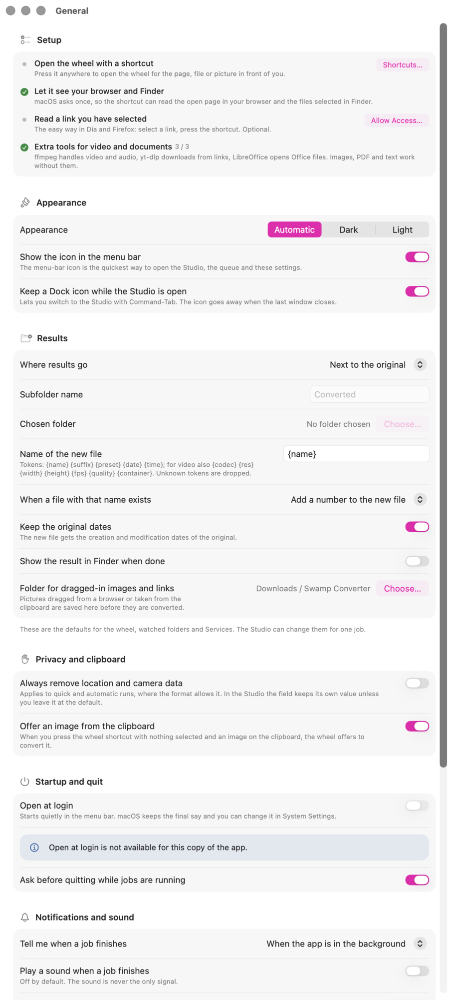
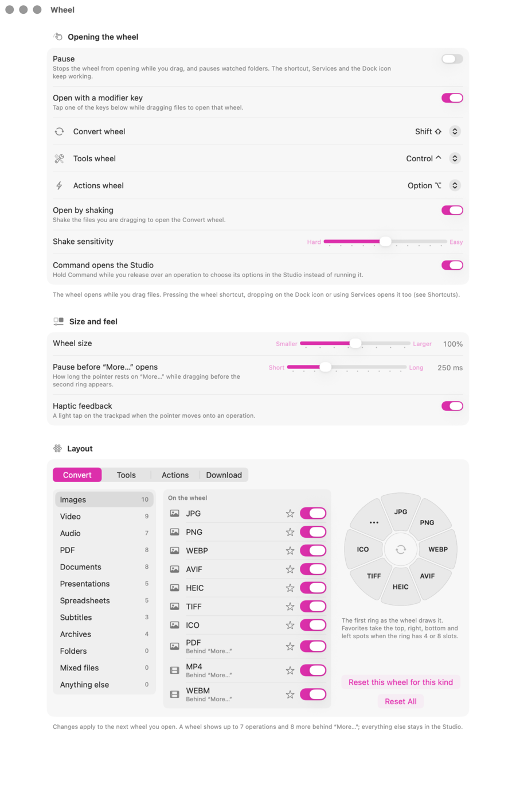
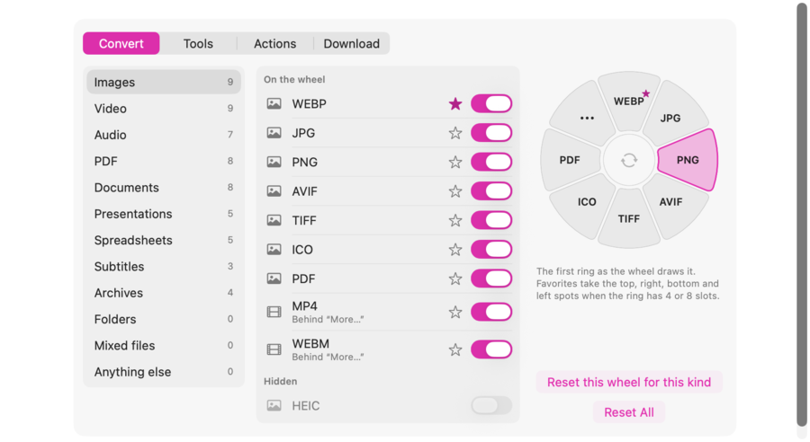
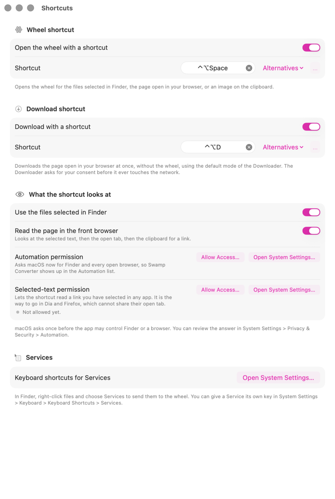
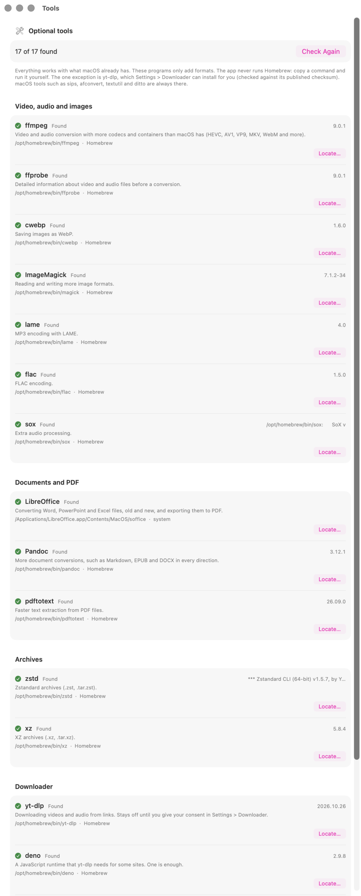
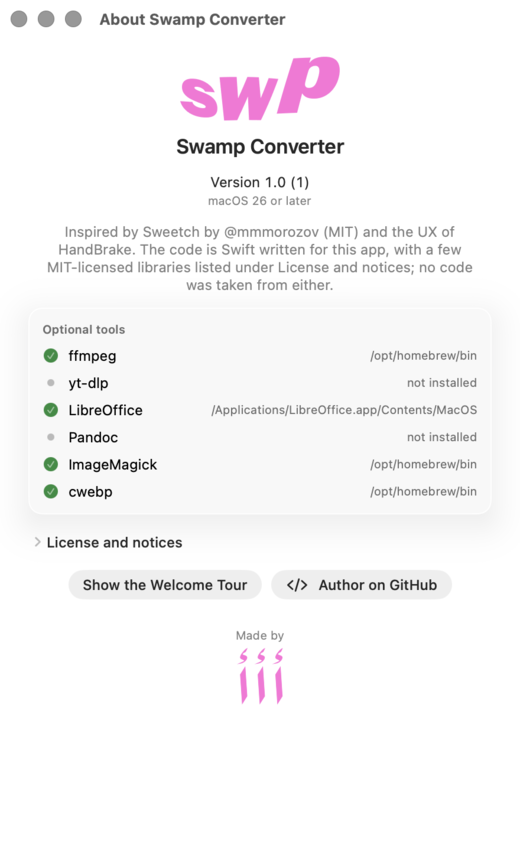

# Settings reference

Every page of **Settings**, with the real defaults. Open it from the menu-bar icon (*Settings…*) or the app menu (**⌘,**). For the everyday story start with the [guide](GUIDE.md); this page is for when you want to change something.

Pages, in the order of the sidebar: [General](#general) · [Wheel](#wheel) · [Shortcuts](#shortcuts) · [Recipes](#recipes) · [Folders](#folders) · [Tools](#tools) · [Downloader](#downloader) · [About](#about)

Nothing on these pages asks macOS for anything by itself. Only a button that says so (*Allow Access…*, *Turn On*) does.

---

## General

| Section | What it holds | Default |
|---|---|---|
| **Setup** | A checklist of what is switched on and what is not: the wheel shortcut, access to your browser and Finder, reading a selected link, starting with your Mac, extra tools. Each open item has one button. Once the needed items are done, the section folds into one line (*Everything needed is set up*). | open while something needed is missing |
| **Appearance** | *Automatic* (follows the Mac), *Light* or *Dark*. *Show the icon in the menu bar*. *Keep a Dock icon while the Studio is open* (so **⌘Tab** reaches it; the icon goes away when the last window closes). | Automatic; both on |
| **Results** | Where results go: *Next to the original*, *In a subfolder next to the original* (name it; `Converted` by default), or *In a folder I choose*. The **name template** of the new file: `{name}`, `{suffix}`, `{preset}`, `{date}`, `{time}`, and for video also `{codec}`, `{res}`, `{width}`, `{height}`, `{fps}`, `{quality}`, `{container}`; unknown tokens are dropped. What to do when a file with that name exists: *Add a number to the new file*, *Replace the existing file*, or *Skip that file*. *Keep the original dates*. *Show the result in Finder when done*. The folder where pictures dragged from a browser or taken from the clipboard are saved first. | next to the original; `{name}`; add a number; keep dates on; reveal off; `Downloads / Swamp Converter` |
| **Privacy and clipboard** | *Always remove location and camera data* from quick and automatic runs where the format allows it (in the Studio the field keeps its own value unless you left it at the default). *Offer an image from the clipboard*: with nothing selected and a picture on the clipboard, the wheel shortcut offers to convert it. | off; on |
| **Startup and quit** | *Open at login*: starts quietly in the menu bar. It is switched on the first time an installed copy starts (macOS shows its own "Login Item Added" notice), and macOS keeps the final say. *Ask before quitting while jobs are running*. | on; on |
| **Notifications and sound** | *Tell me when a job finishes*: *When the app is in the background*, *Always* or *Never*. *Play a sound when a job finishes* (a sound is never the only signal). A shortcut to the macOS notification settings. | in the background; sound off |
| **Performance** | *Jobs at the same time*: never more than your Mac has performance cores (at most 8), and fewer in Low Power Mode or when the Mac is hot. *Pause automatic work on battery* (watched folders and chains wait for power). *Check free space before a job* (warns, or refuses to start, when the result would not fit). | 2; off; on |
| **Actions wheel** | The **Terminal app** used by *Terminal: open here* (Terminal, or any other app you pick). *Keep the shelf between launches*: the shelf holds files you set aside from the Actions wheel. | Terminal; off |

## Wheel

**Opening the wheel**

| Setting | What it does | Default |
|---|---|---|
| **Pause** | Stops the wheel from opening while you drag, and pauses watched folders. The shortcut, Services and the Dock icon keep working. The same switch is *Pause Gestures* in the menu-bar menu. | off |
| **Open with a modifier key** | Tapping one key during a drag opens the wheel that key belongs to. | on |
| **Convert wheel / Tools wheel / Actions wheel** | The key for each wheel: *None*, *Shift*, *Control*, *Option* or *Command*. One key opens one wheel, so choosing a key another wheel already uses **swaps** the two. *None* switches that wheel's key off. | Shift / Control / Option |
| **Open by shaking** | Shaking the dragged files opens the **Convert** wheel, whatever keys you assigned. With the default sensitivity it takes a quick side-to-side wave: five turnarounds of at least 47 points within 0.8 s. | on |
| **Shake sensitivity** | From *Hard* to *Easy*: how many turnarounds and how far each must go (*Easy* needs three short ones, *Hard* six long ones). | middle |
| **Command opens the Studio** | Holding **Command** while you release over an operation opens it in the Studio instead of running it. | on |

**Size and feel**

| Setting | Range | Default |
|---|---|---|
| **Wheel size** | 80 % to 120 % | 100 % |
| **Pause before "More…" opens** | how long the pointer rests on *More…* before the second ring appears, 100 to 600 ms | 250 ms |
| **Haptic feedback** | a light tap on the trackpad as the pointer moves onto an operation | on |

**Layout**

A ring holds up to **8 sectors**. With more than 8 operations it shows **7 and a *More…* sector with up to 8 more behind it**; everything else stays in the Studio, and the editor marks those rows *Studio only*. The layout is kept per wheel and per kind of file (pictures, video, PDF and so on). Drag a row onto another to reorder it (or use its context menu), use the switch to show or hide an operation, and the star to make it a **favourite**: favourites take the top, right, bottom and left spots when the ring has 4 or 8 slots. A live preview shows the first ring. *Reset this wheel for this kind* and *Reset All* bring the defaults back. Changes apply to the next wheel you open. An operation that cannot work for the files at hand (a missing tool) still appears on the wheel, dimmed, with a hint.

## Shortcuts

| Section | What it does | Default |
|---|---|---|
| **Wheel shortcut** | Opens the wheel for the files selected in Finder, the page open in your browser, or an image on the clipboard. Click the field and press a new chord to change it. | **⌃⌥Space**, or the next free chord (usually **⌃⌥⌘Space**) when macOS already owns it |
| **Download shortcut** | Downloads the page open in your browser at once, in the Downloader's default mode, without the wheel. The Downloader still asks for your consent before it touches the network. | **⌃⌥D** |
| **What the shortcut looks at** | Two switches: *Use the files selected in Finder* and *Read the page in the front browser* (it looks at the selected text first, then the open tab, then the clipboard). Below them, two buttons: **Allow Access…** under *Automation permission* (asks macOS now for Finder and every open browser) and **Allow Access…** under *Selected-text permission* (the way to go in Dia and Firefox, which do not report their open tab). | both on |
| **Shortcut status** | Appears only when something needs saying: a chord macOS owns, or a clash between the two shortcuts. The page always shows the chord that is really registered. | hidden |
| **Services** | In Finder, right-click files and choose *Services* to send them to the wheel. A button opens the macOS page where a Service can get its own key. | n/a |

## Recipes

A **recipe** is what the wheel, Services and watched folders do *without asking*: the options of an operation. The Studio can still change them for one job.

| Section | What it does | Default |
|---|---|---|
| **Quality** | Four sliders and one menu that feed the matching quick recipes: *JPEG and WebP quality* (40 to 100), *Image compression quality* (20 to 95), *PDF to images resolution* (a menu: 72, 96, 150, 200, 300, 450 or 600 dpi), *Video quality (H.264)* (16 to 32, lower is better and bigger), *Compressed video quality* (20 to 40). | 90, 70, 300 dpi, 23, 28 |
| **Quick recipe of an operation** | Pick any operation and edit its options. Only your changes are stored, so everything you leave alone keeps following the app's defaults; *Reset* returns the built-in recipe. | built-in recipes |
| **Presets** | Saved sets of options, grouped *Web*, *Devices*, *Social*, *Archive*, *Small size*, *Lossless* and your own. Built-in presets cannot be edited, but *Duplicate* makes an editable copy. *Import…* and *Export My Presets…* share them as `.swampreset` files. | built-in set |

## Folders

A **watched folder** converts new files automatically, in the background. **Nothing is watched until you add a folder**, and results are never processed again.

- **Add Folder…** opens a small editor: the folder, the operation or preset to apply, whether to include subfolders. Each row has a switch and a menu: *Edit…*, *Process Files Already in the Folder…* (it asks first; originals are never deleted), *Show in Finder*, *Remove*.
- **Ready-made rules** are all off. Each one watches one folder and reacts only to the files it describes: *Screenshots to WebP*, *Screenshots to JPG*, *Incoming HEIC to JPG*, *Big movies to HEVC*, and a **Drop folder** you set up yourself.
- The **Pause** switch of the Wheel page (and *Pause Gestures* in the menu) pauses watched folders too. *Pause automatic work on battery* in General makes them wait for power.

## Tools

Everything works with what macOS already has (`sips`, `afconvert`, `textutil`, `ditto` and friends). The optional programs only **add formats**, and the app never runs Homebrew for you:

| Group | Programs | They unlock |
|---|---|---|
| Video, audio and images | ffmpeg, ffprobe, cwebp, ImageMagick, lame, flac, sox | more codecs and containers (HEVC, AV1, VP9, MKV, WebM), WebP, more image formats, MP3 and FLAC encoders |
| Documents and PDF | LibreOffice, Pandoc, pdftotext | Word, PowerPoint and Excel files in either direction, more document conversions, faster text extraction |
| Archives | zstd, xz | `.zst` and `.xz` archives |
| Downloader | yt-dlp, deno, node, bun, quickjs | downloading from links; one JavaScript runtime is enough |

Each row shows *Found* or *Not installed*, the version, where it was found, and what it unlocks. For a missing one: *Copy Command* (for example `brew install ffmpeg`) and run it yourself in Terminal. **Locate…** lets you point at a copy in an unusual place and *Use Default* undoes it. *Check Again* rescans. The one exception to "you install it yourself" is yt-dlp, which the Downloader page can install for you.

## Downloader

The only part of the app that touches the network, and only after you agree.

| Section | What it does | Default |
|---|---|---|
| **Download from links** | *I agree to the notice*. Downloading uses the internet and the free program yt-dlp; **nothing is downloaded while this is off.** Use it only for content you have the right to download. | off |
| **yt-dlp** | Whether it is installed, its version and where it was found. **Install yt-dlp** downloads it from GitHub over HTTPS and checks it against the official SHA-256 checksum; if the check fails, nothing is installed. A note records the version, the date and that checksum, and warns if the file on disk later changes. A copy managed elsewhere (Homebrew) is updated there. *Check for updates when I download* asks github.com once a day and only tells you. | not installed; updates off |
| **JavaScript runtime** | YouTube and some other sites need one of deno, node, bun or quickjs. The status says which was found and *Check Again* rescans. | n/a |
| **Sites that ask you to sign in** | For age-restricted or sign-in-only videos, pick the browser whose cookies yt-dlp may read while it downloads: *Safari*, *Google Chrome*, *Firefox*, *Microsoft Edge* or *Brave*. The app does not store them. | don't use cookies |
| **Defaults** | What the quick path uses (the wheel, the shortcut, the menu bar): the *Mode for the hotkey* (*Best for Apple*, *Maximum quality*, *Universal*, *Audio M4A*, *Audio MP3*), *After download* (*Keep as downloaded*, *Best for Apple*, *Universal*), the save folder (`Movies / Swamp Converter`, and `Music / Swamp Converter` for sound), the file-name template, whether to write the title, chapters and cover into the file, and subtitles (languages, and burning them into the picture when your ffmpeg can draw subtitles). | Best for Apple, then convert; subtitles off |
| **Speed** | *Limit the speed*, and *Parallel parts* (1 to 8): more parts download a video faster on a good connection, 1 is gentler. | no limit; 4 |
| **From any browser** | A bookmarklet. Paste the line as the address of a bookmark; clicking it sends the open page to Swamp Converter (`swampconverter://download`). The way for Firefox, which does not share its address. | n/a |
| **Reading the link from a browser** | The **Allow Access…** button for browsers, same as on the Shortcuts page. | n/a |
| **Recent network activity** | Everything this app asked the network to do since it started, by site name only. | empty |

## About

Version and build, the licence and notices, the status of the six programs the app leans on most (ffmpeg, yt-dlp, LibreOffice, Pandoc, ImageMagick, cwebp; the Tools page lists all of them), **Show the Welcome Tour** (the four-page first-run tour, any time), a link to the author's GitHub, and the author's mark.

---

Back to the [guide](GUIDE.md) · [how it is built](ARCHITECTURE.md) · [what was tested](conversion-matrix.md)
